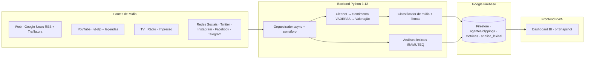

# ValorPúblico — BI & Monitoramento de Mídia Política

Plataforma de **Business Intelligence + Web Scraping/Clipping** que consolida a
presença midiática e digital de **50 vereadores** de Cuiabá e Várzea Grande (MT),
convertendo menções, alcance e valoração espontânea da mídia em inteligência de
imagem e reputação política.

**Produção:** https://valorpublico.web.app

---

## Funcionalidades

- **Camada DSM (nov/2026):** inteligência de clipping de nível institucional —
  **menção direta/indireta/indeterminada** com papel e porta-vozes, **trecho
  citado** com destaque, **radar de propaganda pública** (institucional/oficial/
  utilidade pública, com órgão e símbolos), **alertas acionáveis** (negativa
  direta, tier-1 negativo, alto valor, falha de coleta), **compliance eleitoral**
  (motor da Lei 9.504/1997: arts. 39, 39-A, 40, 45, 49, 53, 55, 56 e 57-A),
  **AVPE/centimetragem** (cm² × R$/cm² e R$/minuto), **cobertura & SLA**
  (publicação→disponibilidade, cobertura por tier, veículos ausentes) e
  **newsletter consolidada** em HTML (e-mail/PDF) + texto para WhatsApp.
  Detalhes em [`CAMADA_DSM.md`](CAMADA_DSM.md).
- **Monitoramento multi-plataforma:** Web (Google News RSS + Trafilatura), **YouTube
  (ativo, com transcrição das falas)**, Twitter/X, Instagram, Facebook, Telegram,
  **TV, Rádio (transcrição de falas) e Impresso**.
- **Share de mídia destrincado:** a origem Web é classificada em Portal, Rádio, TV,
  Jornal Impresso, Governo e Redes (`processing/classificador_midia.py`).
- **Pipeline NLP:** limpeza/deduplicação (pandas) + sentimento (VADER expandido com
  léxico em português).
- **Valoração financeira espontânea (R$):** CPM por plataforma + tabela de veículos.
- **Dashboard PWA em tempo real:** KPIs com tendência, **filtros de período (Hoje/7d/30d)**,
  **série temporal por sentimento (3 linhas)**, **insights principais**, **nuvem de palavras
  interativa com filtro mensal**, share de mídia destrincado, sentimento, valoração por
  plataforma e Top 10 fontes (com filtro por tipo) — Firestore `onSnapshot`. Botão **↻ Atualizar**.
- **Temas/categorias por notícia:** 16 temas (Política/Câmara, Eleições, Governo, Justiça,
  Tecnologia...) classificados por palavras-chave (`processing/temas.py`).
- **Detalhe de notícia:** modal com valoração (R$/alcance/plataforma), categorias, palavras-chave,
  conteúdo e link original.
- **Relatórios / pesquisa avançada:** filtros por período, tipo de mídia e sentimento com
  somatórios de menções, valor (R$) e espaço — com **Exportação PDF** (via impressão do
  navegador **e** PDF nativo pelo backend: `scripts/gerar_relatorio_pdf.py`, reportlab).
- **Tema claro/escuro:** botão de alternância (☀/☾) com **claro como padrão**, persistido
  em `localStorage`; gráficos acompanham o tema.
- **Somatório de espaço real:** caracteres (site) · minutos (TV/rádio/YouTube) · cm²
  (impresso), registrados na ingestão e agregados em `espaco_total` no Relatório.
- **Testes de regras (Emulator Suite):** `backend/tests/` — `npm test` valida o RBAC do
  Firestore (leitura pública do dashboard, clippings bloqueados, RBAC de usuários).
- **Análise de Mídia:** abas Estatística, Qualitativa e Repercussão Negativa.
- **Análises lexicais (estilo IRAMUTEQ):** frequência, especificidade por período,
  co-ocorrência/similaridade, AFC (mapa fatorial) e CHD (classes temáticas com Ward).
  **Visualização no dashboard:** mapa fatorial (AFC), classes temáticas (CHD),
  **dendrograma da CHD** (árvore de Ward em SVG) e grafo de similaridade interativo
  (`scripts/analise_lexical_escopos.py` → coleção `analise_lexical`, por escopo).
- **Avaliação IA do sentimento (opcional):** módulo plugável (`processing/sentimento_ia.py`)
  compatível com OpenAI/Groq/Ollama etc.; sem API key, cai automaticamente para VADER + léxico PT.
  Backfill do corpus histórico via `scripts/reclassificar_sentimentos.py` (modos `--plano`/`--aplicar`).
- **"Últimas Notícias" e "Histórico da Ingestão":** painéis no dashboard — notícias recentes
  clicáveis (abrem o modal de detalhe) e as últimas 15 execuções do motor (sucesso/erro).
- **Análise lexical filtrada pelos filtros:** análise por escopo (`analise_lexical_escopos.py`
  → `analise_lexical/{geral,cidade-*,agente-*,periodo-*}`), carregada conforme os filtros
  de cidade/parlamentar/período no dashboard, com rótulo do escopo ativo.
- **Exportação CSV** de auditoria com todos os clippings + metadados + temas.
- **Monitoramento e alertas:**
  - Erros de JS **visíveis na tela** (banner vermelho) — qualquer falha no dashboard.
  - **Indicador de saúde da ingestão** no rodapé (OK / atrasada / desatualizada / erro).
  - **Status detalhado da última execução** (sucesso/erro, clippings gravados).
  - **Issue automática no GitHub** quando a ingestão do cron falhar.
- **Agendamento:** GitHub Actions (cron diário) + rotina local para Windows.

## Arquitetura

```
Backend (Python 3.12)  ->  Scrapers -> Orquestrador (async/sync + agentes em paralelo)
                              -> Cleaner -> Sentimento -> Valoração
                              -> Análises lexicais (numpy/scipy/sklearn)
                              -> Firestore (subcoleção clippings)
Frontend (PWA/JS)      ->  Dashboard BI (tempo real via onSnapshot)
Agendamento            ->  GitHub Actions / rotina local
```

**Arquitetura (Mermaid):**



- **Banco:** Google Firebase Firestore (NoSQL) — `agentes_publicos/{id}/clippings`,
  `metricas`, `metricas_por_cidade`, `metricas_por_agente`, `tabela_midia`,
  `usuarios`, `execucoes_ingestao`.
- **Segurança:** `firestore.rules` com leitura pública do dashboard; escrita
  restrita ao backend (Admin SDK).

## Estrutura

```
backend/
  config/         settings (.env) e convenções
  core/           cliente Firebase e logging
  scraper/        scrapers + orquestrador + modelos
  processing/     cleaner, sentiment (VADER PT), valoracao, classificador de mídia,
                  nuvem de palavras e análises lexicais (IRAMUTEQ)
  storage/        repositório Firestore
  scripts/        seed, ingestão, métricas, export CSV, análise lexical, owner, rotina
frontend/         PWA (dashboard, service worker, manifest)
firestore.rules   Security Rules (RBAC)
```

## Como executar

### Pré-requisitos
- Python 3.12+, `firebase-admin`, `pandas`, `numpy`, `scipy`, `sklearn`,
  `httpx[http2]`, `trafilatura`, `feedparser`, `yt-dlp` (ver `backend/requirements.txt`).
- Conta de serviço do Firebase (`FIREBASE_SERVICE_ACCOUNT` no `.env`).

### Instalação
```powershell
cd backend
pip install -r requirements.txt
Copy-Item .env.example .env   # edite com suas credenciais
```

### Pipeline
```powershell
# 1. Popular agentes (50 parlamentares)
python scripts/seed_firebase.py

# 2. Tabela de valoração (CPM + veículos)
python scripts/seed_tabela_midia.py

# 3. Ingestão (retomada: apenas agentes sem dados)
python scripts/run_ingestao.py --apenas-sem-dados

# 4. Regenerar métricas
python scripts/atualizar_metricas.py

# 5. Recriar owner (RBAC)
python scripts/criar_owner.py
```

### Auditoria e análises
```powershell
# Exporta todos os clippings para CSV (auditoria/busca)
python scripts/exportar_clippings.py

# Análises lexicais estilo IRAMUTEQ (gera data/export/lexical/)
python scripts/analise_lexical.py
python scripts/analise_lexical.py --n-classes 6   # ajusta classes da CHD
python scripts/analise_lexical.py --niveis-dendrograma 8   # níveis do dendrograma

# Publica as análises lexicais no Firestore (alimenta o dashboard)
python scripts/publicar_lexical.py

# Publica análise lexical por escopo (geral/cidade/agente/período) — alimenta
# a seção filtrada pelos filtros no dashboard
python scripts/analise_lexical_escopos.py
python scripts/analise_lexical_escopos.py --n-classes 4 --niveis 8

# Gera relatório em PDF nativo (reportlab) a partir das métricas
python scripts/gerar_relatorio_pdf.py                  # geral
python scripts/gerar_relatorio_pdf.py --agente <id>    # por parlamentar
python scripts/gerar_relatorio_pdf.py --cidade cuiaba  # por cidade
python scripts/gerar_relatorio_pdf.py --saida relatorio.pdf

# Backfill do sentimento com IA (reclassifica o corpus histórico)
python scripts/reclassificar_sentimentos.py --plano     # estima custo, não grava
python scripts/reclassificar_sentimentos.py --aplicar   # classifica e grava
```

### Agendamento
- **Nuvem:** `.github/workflows/ingestao.yml` (cron 06:30/18:30 UTC). Configure os
  secrets `FIREBASE_DATABASE_URL` e `FIREBASE_SERVICE_ACCOUNT_B64` (e opcionalmente
  `TV_CANAIS`, `RADIO_CANAIS`, `IMPRESSO_SITES`). Roda ingestão + métricas + análise
  lexical. Em caso de falha, o workflow **abre uma issue de alerta** automática no
  GitHub (com link para os logs).
- **Local:** `backend/scripts/rotina_diaria.ps1` (via Agendador de Tarefas).

### Deploy
```powershell
firebase deploy --only hosting,firestore:rules
```

## Documentação

- `context.md` — contexto estratégico, estado atual e análises lexicais.
- `implementation.md` — plano de sprints (até Go live + melhorias contínuas).

## Status e pendências

**Em andamento:** **Fase 5 — legibilidade das análises lexicais** (zoom/pan no grafo,
dendrograma e AFC; classes variando claramente com o filtro; ver sprints 29–33 no
`implementation.md`); credenciais das redes sociais; Telegram (`API_ID`/`API_HASH`);
e-mail/SMS de alerta.

**Concluídos recentemente:** tema claro/escuro, somatório de espaço real (caracteres/min/cm²),
PDF nativo via backend (`gerar_relatorio_pdf.py`), testes de regras no Emulator Suite.

Veja `implementation.md` (Fase 4 e 5) e `context.md` (§11 Próximos Passos) para a lista
completa e o que já foi entregue.

## Segurança

- Nunca versionar `.env`, `serviceAccountKey*`, `frontend/firebase-config.js`,
  cookies/sessões/proxies (ver `.gitignore`).
- A API key web do Firebase (em `frontend/js/firebase-init.js`) é **pública por
  design** e não é um segredo.


## Interface e movimento (nov/2026) — "Newsroom institucional"

- Masthead com edição do dia e nav horizontal; papel, serifa (Newsreader) e bronze.
- Telas: `#/painel`, `#/midia`, `#/parlamentares`, `#/inteligencia`, `#/relatorios`,
  `#/sistema` (`js/router.js`).
- Login em página inteira, com capa 3D isométrica própria; em modo restrito o painel só inicia
  depois do login.
- Ativos próprios em `frontend/icons/` (SVG, PNGs e maskable).
- Temas claro (padrão) e escuro, com alternador no masthead/Sistema.
- **Esqueci minha senha** na tela de login; template do e-mail em `docs/emails/`.
- Motion em `frontend/assets/motion/` (hero do login, splash, faixa e transição de aba).