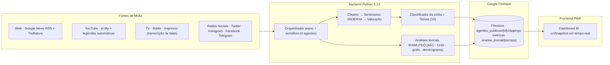
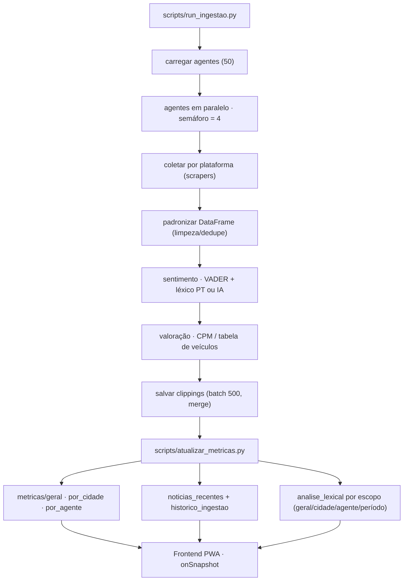

# ValorPúblico — Plano de Implementação (Sprints)

> Roteiro de execução da plataforma, da base até o **go live** e melhorias contínuas.
> Atualizado em: 20/08/2026 (go live + sessão de auditoria, destrinche de mídia e análises lexicais).

---

## Resumo Geral de Sprints

| Sprint | Tema | Entrega principal | Status |
|---|---|---|---|
| 0 | Setup do projeto | Repositório, estrutura, convenções, `.gitignore` | ✅ Concluída |
| 1 | Modelo de dados e seed | Coleção `agentes_publicos` (50 parlamentares) + `termos_de_busca` | ✅ Concluída |
| 2 | Motor de ingestão (Web) | Google News RSS + Trafilatura | ✅ Concluída |
| 3 | Scrapers de redes sociais | Twitter, Instagram, Facebook | ✅ Concluída |
| 4 | Scrapers multimídia/mensageria | YouTube, Telegram | ✅ Concluída |
| 5 | Pipeline NLP e persistência | Limpeza (pandas) + sentimento (VADER PT) + Firestore | ✅ Concluída |
| 6 | Métricas agregadas | `metricas` por geral/cidade/agente + série diária | ✅ Concluída |
| 7 | Dashboard PWA | KPIs, filtros, gráficos, tempo real | ✅ Concluída |
| 8 | Controle de acesso (owner) | Coleção `usuarios` + script de owner | ✅ Concluída |
| 9 | **Deploy (Firebase Hosting)** | PWA publicado em `valorpublico.web.app` | ✅ Concluída |
| 10 | **Valoração financeira da mídia** | Tabela R$/espaço + `valor_estimado` no pipeline/dashboard | ✅ Concluída |
| 15–18 | **Layout do painel executivo** | Dark mode, KPIs com tendência, gráficos, responsividade | ✅ Concluída |
| — | **Ingestão Web (retomada)** | Completar clippings dos 50 agentes | ✅ Concluída (50/50, 1.510 clippings) |
| 11 | Agendamento da ingestão | GitHub Actions (cron) + rotina local | ✅ Concluída |
| 12 | Regras de Security (RBAC) | Firestore Rules por papel | ✅ Concluída |
| 13 | Cobertura TV/Rádio/Impresso | Transcrição + valoração de falas | ✅ Concluída |
| 14 | **Go live** | Homologação, monitoramento, documentação final | ✅ Concluída |
| 19 | **Auditoria, destrinche de mídia e YouTube** | Classificador de mídia, YouTube ativo, export CSV | ✅ Concluída |
| 20 | **Analytics e análise lexical (IRAMUTEQ)** | Série por sentimento, nuvem interativa, análises lexicais | ✅ Concluída |
| 21 | Filtros de período no dashboard | Hoje / 7d / 30d / Todo (KPIs, série, share, top) | ✅ Concluída |
| 22 | Insights Principais e Top Veículos | Cards de destaque + top com filtro por tipo | ✅ Concluída |
| 23 | Categorias/temas por notícia | 16 temas por palavras-chave + backfill | ✅ Concluída |
| 24 | Detalhe de notícia | Modal com valoração, categorias, conteúdo, palavras-chave | ✅ Concluída |
| 25 | Pesquisa avançada / Relatórios | Filtros + somatórios de espaço/valor/sentimento | ✅ Concluída |
| 26 | Análise de Mídia | Abas estatística/qualitativa/repercussão negativa | ✅ Concluída |
| 27 | Exportação PDF de relatório | PDF via impressão do navegador | ✅ Concluída |
| 28 | **Monitoramento e alertas** | Erros na tela, saúde da ingestão, status, issue no cron | ✅ Concluída |

**Status total:** 29 sprints/entregas concluídas · pendências pontuais listadas abaixo.

---

## Sprint 0 — Setup do Projeto ✅
Fundação do repositório, estrutura `backend/`+`frontend/`, `.gitignore` robusto,
`.env.example`, política de segurança (nunca versionar credenciais).

## Sprint 1 — Modelo de Dados e Seed ✅
`agentes_publicos` com 50 parlamentares (27 Cuiabá + 23 Várzea Grande), `termos_de_busca`
gerados automaticamente (nome + cargo + partido, com/sem acento), escrita idempotente.

## Sprint 2 — Motor de Ingestão (Web) ✅
`web_scraper.py` (Google News RSS + `feedparser` + `Trafilatura`), cliente furtivo `httpx[http2]`
com delays randômicos, retry/backoff e rotação de proxies.

## Sprint 3 — Scrapers de Redes Sociais ✅
`twitter_scraper.py` (`twscrape`), `instagram_scraper.py` (`instaloader`),
`facebook_scraper.py` (`Playwright` + stealth). **Requerem credenciais reais** para operar.

## Sprint 4 — Scrapers Multimídia e Mensageria ✅
`youtube_scraper.py` e `telegram_scraper.py` (Telethon). YouTube reescrito para operar via CLI
`yt-dlp` + legendas automáticas (ver Sprint 19); Telegram exige `API_ID`/`API_HASH`.

## Sprint 5 — Pipeline NLP e Persistência ✅
`processing/cleaner.py` (pandas: remove URL/emoji/boilerplate, deduplica, trata `NaT`),
`processing/sentiment.py` (VADER + léxico PT), `storage/firestore_repo.py` (batch 500, merge).

## Sprint 6 — Métricas Agregadas ✅
`atualizar_metricas.py` grava `metricas/geral`, `metricas_por_cidade/<slug>`,
`metricas_por_agente/<id>` com distribuição por categoria/sentimento, Top 10 e série diária.

## Sprint 7 — Dashboard PWA ✅
`index.html` + `css/styles.css` + `js/app.js` + `js/charts.js` (Chart.js), filtros
cidade/parlamentar, `onSnapshot` em tempo real, `manifest.json` + `sw.js` (offline-first).

## Sprint 8 — Controle de Acesso (owner) ✅
Coleção `usuarios/{uid}` + `criar_owner.py` (base para RBAC na Sprint 12).

## Sprint 9 — Deploy (Firebase Hosting) ✅
`firebase.json` (2 targets), `.firebaserc`, correções de cache/MIME do SW,
config embutida em `js/firebase-init.js`. Produção: https://valorpublico.web.app

## Sprint 10 — Valoração Financeira da Mídia ✅
`tabela_midia/geral` (CPM + veículos), `processing/valoracao.py` (CPM por alcance p/ redes;
tabela p/ Web/Impresso), integrado ao `Orchestrator` e ao dashboard.

## Sprint 11 — Agendamento da Ingestão ✅
GitHub Actions `.github/workflows/ingestao.yml` (cron 06:30/18:30 UTC) + `rotina_diaria.ps1`.
Secrets configurados (`FIREBASE_DATABASE_URL`, `FIREBASE_SERVICE_ACCOUNT_B64`).

## Sprint 12 — Regras de Security (RBAC) ✅
`firestore.rules` — leitura pública do dashboard; escrita restrita ao Admin SDK.
- [ ] (Pendente) Testes automatizados de regras (Emulator Suite).

## Sprint 13 — Cobertura TV, Rádio e Impresso ✅
`tv_radio_scraper.py` e `impresso_scraper.py` com valoração específica.
- [ ] (Ajuste de campo) Ampliar `MIDIA_VIDEOS_POR_CANAL` e canais de rádio reais; hoje os
  vídeos atuais não citam vereadores (0 clippings) e os portais não expõem RSS.

## Sprint 14 — Go Live ✅
Homologação (50/50 agentes, 1.510+ clippings), monitoramento (`ultima_execucao`), README,
context/implementation atualizados, secrets + workflow validados.

## Sprint 19 — Auditoria, Destrinche de Mídia e YouTube ✅

**Objetivo:** destrinchar a origem "Web" por categoria de mídia e ativar o YouTube.
- [x] **Classificador de mídia** (`processing/classificador_midia.py`) — mapeia cada veículo/domínio
  para Portal, Rádio, TV, Jornal Impresso, Governo, Redes Sociais, YouTube, Telegram.
- [x] **Métricas destrincadas** — `atualizar_metricas.py` usa o classificador no share de mídia
  (correção: `set()` sobrescreve o doc inteiro — evita merge profundo de mapas).
- [x] **YouTube ativo** — `youtube_scraper.py` reescrito para CLI `yt-dlp` (busca pelo nome do
  agente) + transcrição via **legendas automáticas** (o `youtube-transcript-api` retornava vazio);
  parser VTT com merge por sobreposição de palavras; cache 1x por vídeo/canal.
- [x] **TV/Rádio/Impresso robustos** — `tv_radio_scraper.py` e `impresso_scraper.py` com cache
  por canal/site (1x por execução) e transcrição por legendas.
- [x] **Ingestão paralela entre agentes** — `Orchestrator` com `asyncio.Semaphore`
  (`PARALELISMO_AGENTES`, padrão 4) — redução de ~4x no tempo.
- [x] **Export CSV de auditoria** — `scripts/exportar_clippings.py` → `data/export/clippings_YYYYMMDD.csv`
  (UTF-8 BOM + `;`, colunas de agente + clipping + metadados + `categoria_midia`).

## Sprint 20 — Analytics e Análise Lexical (IRAMUTEQ) ✅

**Objetivo:** enriquecer o dashboard e habilitar análises lexicais do corpus (estilo IRAMUTEQ).
- [x] **Série temporal por sentimento** — 3 linhas no gráfico (Positivo verde, Neutro azul,
  Negativo vermelho) com cores mapeadas **por rótulo** (fix de cores).
- [x] **Nuvem de palavras interativa** — `metricas` com `nuvem_geral` + `nuvem_por_mes`;
  dashboard com filtro de período (mês) e tooltip de contagem.
- [x] **Botão "Atualizar"** no header — limpa caches do SW, desregistra o SW e recarrega
  (traz as atualizações do desenvolvimento).
- [x] **Stopwords e limpeza de corpus** — `processing/nuvem.py` com stopwords PT + remoção de
  ruído RSS (hex-colors, nomes de veículos).
- [x] **Análises lexicais IRAMUTEQ** — `processing/lexical.py` + `scripts/analise_lexical.py`:
  frequência (global/por mês), especificidade (chi2 por período), co-ocorrência + grafo de
  similaridade, AFC (SVD palavra×período) e CHD (Ward + palavras características). Saídas em
  `data/export/lexical/` (CSV + JSON + resumo).
- [ ] (Pendente) Visualização no frontend: mapa fatorial (AFC), grafo de similaridade e
  dendrograma da CHD (os dados já são gerados).

## Estado Atual (20/08/2026)

- ✅ 50 agentes (`agentes_publicos`) + `tabela_midia/geral` (8 CPM + 13 veículos).
- ✅ **Ingestão Web + YouTube** — 50/50 agentes, **1.863 clippings**.
- ✅ **Share de mídia destrincado** — Portal, Jornal Impresso, YouTube, Governo, TV, Rádio
  (+ Redes/Outros) — ver `context.md` para os números atuais.
- ✅ **Métricas com série por sentimento e nuvem** — `metricas/geral` + 2 cidades + 50 agentes.
- ✅ **Export CSV** — `data/export/clippings_20260820.csv` (com `categoria_midia` + `temas`).
- ✅ **Análises lexicais** — `data/export/lexical/` (frequência, especificidade, co-ocorrência,
  AFC, CHD — 4 classes temáticas).
- ✅ **Dashboard** — série por sentimento, nuvem interativa, botão Atualizar, cores corretas;
  deployado em https://valorpublico.web.app.
- ✅ **Firestore Rules** + owner + GitHub Actions — operando.
- ⏳ **Pendências pós-go-live:**
  1. Credenciais das redes sociais (Twitter/Instagram/Facebook) e Telegram (`API_ID`/`API_HASH`).
  2. TV/Rádio/Impresso com dados reais (ampliar canais/janela; hoje 0 menções).
  3. Incluir TV/Rádio/Impresso no cron do GitHub Actions (secrets `TV_CANAIS`/`RADIO_CANAIS`/`IMPRESSO_SITES`).
  4. Visualização das análises lexicais no frontend (AFC/grafo/dendrograma).
  5. Ajustar CPM/valores conforme tabela publicitária real.
  6. Testes de regras no Emulator Suite.
  7. (Fase 3) E-mail/SMS de alerta — hoje a notificação de falha é por issue no GitHub.
  8. (Fase 3) Monitoramento externo de uptime (ex.: UptimeRobot).

---

# Fase 2 — Benchmarking DSM (Dinâmica MT)

> Objetivo: levar o ValorPúblico ao mesmo nível funcional da ferramenta de
> clipping/análise de mídia da **DSM (https://dsm.dinamicamt.com.br)** — mapeada por
> engenharia reversa (login real + captura de UI/rotas) em 20/08/2026 — somando-a às
> funcionalidades já existentes (valoração, análise lexical IRAMUTEQ, nuvem de palavras).

## Funcionalidades da DSM (benchmark mapeado)

| Módulo | Funcionalidades observadas |
|---|---|
| **Dashboard (Início)** | Filtros Hoje/7d/30d/Personalizado + Categorias; KPIs (avaliações, menções pos/neu/neg); veículos monitorados por tipo (WEB/RÁDIO/TV/IMPRESSO/REVISTAS); insights (maior cobertura, veículo destaque, tendência); Top Veículos com filtro por tipo; volume semanal; análise de sentimento (donut %); notícias recentes |
| **Relatórios (Pesquisa avançada)** | Filtros período/estado/município/avaliação/avaliação IA/tipo de veículo/veículo/categorias/termos; lista de notícias (veículo, editoria, tipo, categorias, avaliação); caixa de seleção; **somatório de espaço** (site=caracteres, rádio=tempo, TV=tempo, impresso=cm²), **somatório de valor (R$)** e **somatório de sentimento** |
| **Análise de Mídia** | Abas Análise Estatística / Qualitativa / Repercussão Negativa; filtros data inicial/final, assuntos (busca), tipo de veículo; **EXPORTAR PDF** |
| **Detalhe de notícia** | Valoração (R$ calculado, valor veículo, base de valoração), categorias (agentes/temas), conteúdo e palavras-chave |
| **Painel do cliente** | Busca por título/categoria/estado; categorias WEB/RÁDIO/TV/IMPRESSO; listas de agentes |
| **Redes Sociais** | Em desenvolvimento na DSM (solicitação de acesso antecipado) |

## Sprints de Benchmarking DSM

| Sprint | Tema | Entrega principal | Status |
|---|---|---|---|
| 21 | Filtros de período no dashboard | Hoje / 7d / 30d / Personalizado + categorias (KPIs, série, share, top) | ✅ Concluída |
| 22 | Insights Principais e Top Veículos | Cards de destaque (maior cobertura, veículo destaque, tendência) + top com filtro por tipo | ✅ Concluída |
| 23 | Categorias/temas por notícia | Classificar cada clipping em temas/assuntos (reuso das análises lexicais) | ✅ Concluída |
| 24 | Detalhe de notícia | Modal com valoração (R$/veículo/base), categorias, conteúdo e palavras-chave | ✅ Concluída |
| 25 | Pesquisa avançada / Relatórios | Filtros múltiplos + somatório de espaço/valor/sentimento | ✅ Concluída |
| 26 | Análise de Mídia | Abas estatística/qualitativa/repercussão negativa + filtro de assuntos | ✅ Concluída |
| 27 | Exportação PDF de relatório | Gerar PDF com filtros aplicados (via impressão do navegador) | ✅ Concluída |

### Implementação da Fase 2 (resumo)

- **21 — Períodos:** `atualizar_metricas.py` agora grava `metricas/*.por_periodo` com janelas
  `hoje`, `7d` e `30d` (cada uma com KPIs, categorias, sentimento, top veículos e série);
  o frontend alterna entre elas sem nova consulta.
- **22 — Insights/Top:** `metricas/*.insights` (maior cobertura, veículo em destaque, tendência
  positiva, pct positivo/negativo) e `top_veiculos` com `categoria_midia` por veículo; seção de
  Insights no dashboard + filtro de tipo no Top 10.
- **23 — Temas:** `processing/temas.py` (16 temas por regras de palavras-chave) +
  `scripts/classificar_temas.py` (backfill idempotente, `categorias` no clipping);
  `distribuicao_temas` nas métricas; coluna `temas` no CSV.
- **24 — Detalhe:** modal que abre o clipping (valoração R$/alcance/plataforma, categorias,
  palavras-chave, conteúdo e link original).
- **25 — Relatório:** botão "Relatório" no header + modal de pesquisa avançada com filtros
  (período, tipo de mídia, sentimento), somatórios (menções, valor R$, espaço em caracteres)
  e lista por categoria.
- **26 — Análise de Mídia:** painel com abas Estatística / Qualitativa / Repercussão Negativa.
- **27 — PDF:** botão "Exportar PDF" (imprime a view de relatório via `window.print()`).
- **Deploy:** Fase 2 publicada em https://valorpublico.web.app.

### Decisões e pendências da Fase 2

- **Avaliação IA** (DSM usa IA): no ValorPúblico o sentimento segue VADER; integrar LLM
  (ex.: Gemini/OpenAI) é custo a decidir (Sprint 25). Heurísticas já cobrem os temas.
- **Somatório de espaço** por tipo (site=caracteres, rádio/TV=tempo, impresso=cm²) requer
  registrar metadados de duração/cm² na ingestão (TV/Rádio/Impresso ainda com 0 dados).
- **PDF nativo:** hoje via `window.print()`; gerar PDF servido por backend (reportlab) fica
  como melhoria futura se houver necessidade de relatórios assinados/brandados.
- **Redes sociais:** a própria DSM ainda está em desenvolvimento; manter YouTube ativo e
  configurar credenciais das demais (pendência já listada).

### Sprint 21 — Filtros de período no dashboard

**Objetivo:** permitir escolher o período (Hoje, Últimos 7 dias, Últimos 30 dias, Personalizado)
e por categoria, impactando KPIs, série temporal, share e top veículos.

- **Backend:** enriquecer `metricas/geral` (e por cidade/agente) com **séries por janela** —
  `serie_sentimento_7d`, `serie_sentimento_30d`, `dias_7d`, `dias_30d` — e `total_por_periodo`
  já derivado no servidor (evita filtro pesado no cliente).
- **Frontend:** seletor de período + categorias; os gráficos/KPIs re-renderizam a partir do
  subconjunto de séries escolhido. Reuso da série por sentimento já existente.
- **Modelo:** manter `metricas/*` com janelas pré-computadas (padrão atual de performance).

### Sprint 22 — Insights Principais e Top Veículos

**Objetivo:** cards de "Insights" e ranking de veículos com filtro por tipo de mídia.

- **Backend:** `metricas/geral.insights` = `{maior_cobertura, veiculo_destaque,
  tendencia_positiva, pct_positivo}` e `top_veiculos` com `categoria_midia` por veículo.
- **Frontend:** seção "Insights Principais" (3 cards) + filtro de tipo no Top 10 (Geral /
  WEB / RÁDIO / TV / IMPRESSO).
- **Reuso:** classificador de mídia (`classificador_midia.py`) já fornece a categoria por veículo.

### Sprint 23 — Categorias/temas por notícia

**Objetivo:** além dos agentes, classificar cada clipping em **temas/assuntos** (ex.: Saúde,
Educação, CPI, Eleições), como a DSM faz com "Categorias".

- **Backend:** gerar categorias por clipping — (a) automática por palavras-chave/temas das
  análises lexicais (classes da CHD); (b) manual/configurável por regra de termos
  (`categoria_midia` + `categorias` array no doc do clipping).
- **Modelo:** adicionar campo `categorias: array<string>` no clipping e `distribuicao_categorias_tema`
  nas métricas; incluir no CSV de exportação.
- **Filtros:** permitir buscar/filtrar relatórios por categoria.

### Sprint 24 — Detalhe de notícia

**Objetivo:** página individual do clipping com valoração detalhada, categorias e conteúdo.

- **Frontend:** rota `/noticias/{id}/detalhes` (SPA) mostrando título, veículo, editoria, tipo,
  data; valoração (R$ calculado = `valor_estimado`, valor veículo da tabela, base de valoração
  = alcance/CPM); categorias; conteúdo integral; palavras-chave (top tokens da análise lexical).
- **Backend:** endpoint/query por `id_clipping` (já há subcoleção por agente); agregar
  `valor_veiculo`, `base_valoracao` e `palavras_chave` no doc do clipping.

### Sprint 25 — Pesquisa avançada / Relatórios

**Objetivo:** listar notícias com filtros múltiplos e somatórios (espaço, valor, sentimento).

- **Backend:** endpoint de pesquisa com filtros (período, estado, município, avaliação,
  avaliação IA, tipo de veículo, veículo, categorias, termos) + agregados:
  `somatório espaço` (site=caracteres, rádio=minutos, TV=minutos, impresso=cm²),
  `somatório valor (R$)` e `somatório sentimento`.
- **Frontend:** tela de Relatórios com formulário de filtros, lista selecionável (checkboxes),
  rodapé com somatórios e ações (exportar PDF).
- **Reuso:** classificação `categoria_midia`, sentimento e `valor_estimado` já existentes.

### Sprint 26 — Análise de Mídia

**Objetivo:** abas Estatística, Qualitativa e Repercussão Negativa sobre o corpus.

- **Estatística:** KPIs do período (menções, sentimento, share, top veículos, série).
- **Qualitativa:** usar as análises lexicais IRAMUTEQ (frequência, especificidade, co-ocorrência,
  AFC, CHD) para apresentar temas/classes e palavras características.
- **Repercussão Negativa:** clippings com sentimento negativo + termos de crise, com ranking
  por veículo e período.
- **Frontend:** abas com visualizações (já temos nuvem; integrar mapa fatorial/grafo/dendrograma).

### Sprint 27 — Exportação PDF de relatório

**Objetivo:** gerar PDF do relatório com os filtros aplicados (auditoria/apresentação).

- **Backend:** gerar PDF via `reportlab`/`weasyprint` (a decidir) a partir dos dados filtrados
  (KPIs, somatórios, lista, análises lexicais). Servir como download.
- **Frontend:** botão "Exportar PDF" nas telas de Relatórios e Análise de Mídia.
- **Reuso:** dados já agregados nos módulos anteriores.

## Dependências e ordem sugerida

- **21 e 22** (dashboard) independem das demais → primeiro.
- **23** (categorias/temas) habilita **24** (detalhe) e **25** (pesquisa por categoria).
- **25** e **26** reusam **23** (temas) e a análise lexical já existente.
- **27** (PDF) é o fechamento, consumindo **25** e **26**.

## Riscos / decisões abertas

- **Filtros por período** — pré-computar janelas (hoje/7d/30d) no Firestore é barato; janela
  "personalizada" exigirá query no cliente ou endpoint dinâmico (decidir na Sprint 21).
- **Avaliação IA** (DSM) — hoje o sentimento é VADER; avaliação IA exige LLM (custo). Decidir
  se usa heurística/regras ou integra uma API de LLM (Sprint 25).
- **Somatório de espaço** — precisa registrar tamanho do conteúdo (caracteres) por clipping e
  metadados de duração (rádio/TV) e cm² (impresso) na ingestão.
- **PDF** — escolha da lib de geração e hospedagem (Cloud Function vs local no cron).
- **Redes sociais** — a própria DSM ainda está em desenvolvimento; manter YouTube ativo e
  configurar credenciais das demais (pendência já listada).

---

# Fase 3 — Monitoramento e Alertas

> Implementada em 20/08/2026 (pós-go-live). Garante visibilidade imediata quando algo
> "quebra" (dashboard, ingestão, cron), sem depender de abrir o console do navegador.

| Sprint | Tema | Entrega principal | Status |
|---|---|---|---|
| 28 | Monitoramento e alertas | Erros visíveis na tela, saúde da ingestão, status da última execução, issue automática no cron | ✅ Concluída |

### Sprint 28 — Monitoramento e Alertas ✅

**Objetivo:** detectar e sinalizar falhas de forma proativa em todos os níveis.

- **Frontend — erros visíveis na tela:**
  - `capturarErro()` + handlers globais `window.onerror` e `unhandledrejection` → exibem
    banner vermelho com a mensagem de qualquer falha de JS (sem precisar abrir o console).
  - Erro do `onSnapshot` do Firestore também tratado via `capturarErro` (rótulo de rede/banco).
  - Corrigido modal que travava a tela: `.oculto { display: none !important }` (a regra do
    `.modal-overlay { display: flex }` sobrescrevia o `oculto` e bloqueava os cliques).
- **Indicador de saúde da ingestão (rodapé):**
  - `● OK` (verde) — ingestão recente (<26h).
  - `● Ingestão atrasada` (âmbar) — 26–48h.
  - `● Desatualizado (há mais de 2 dias)` (âmbar) — >48h.
  - `● Última ingestão com erro` (vermelho) — quando `sucesso === false`.
- **Status detalhado da última execução:**
  - Backend: `orchestrator.py` grava `sucesso: True` no resumo; `atualizar_metricas.py`
    propaga `sucesso` + contadores em `metricas/*.ultima_execucao`.
  - Frontend: rodapé mostra data/hora, nº de clippings gravados e estado de saúde.
- **Alerta de falha no cron (GitHub Actions):**
  - Novo passo no workflow (se `failure()`): `actions/github-script` **abre issue de alerta**
    automática no GitHub (evitando duplicar se já houver issue aberta), com link para a run
    e os logs (artefato `logs-ingestao`).
- **Deploy:** publicado em https://valorpublico.web.app.

### Estado atual (Fase 3)

- ✅ Erros de JS visíveis na tela (banner vermelho).
- ✅ Indicador de saúde da ingestão + status detalhado da última execução.
- ✅ Issue automática de falha no cron.
- ✅ Métricas regeneradas (1.863 clippings; `ultima_execucao` com `sucesso: true`).

### Pendências pós-Fase 3

- E-mail/SMS de alerta (hoje a notificação é por issue no GitHub; e-mail exige um provedor SMTP).
- Monitoramento externo de uptime (ex.: UptimeRobot) para detectar queda do site.
- ~~Dashboard da última execução com histórico~~ ✅ **Histórico da Ingestão** implementado:
  `metricas/geral.historico_ingestao` (últimas 15 execuções) + painel no dashboard.
- ✅ **Detalhe de notícia acessível** — `metricas.*.noticias_recentes` (10 clippings mais
  recentes com veículo/agente/sentimento/valor) + painel "Últimas Notícias" clicável que
  abre o modal de detalhe (fecha a Sprint 24, que estava sem ponto de entrada no dashboard).
- ✅ **Gráficos aprimorados** — paleta ampliada (14 cores), Share de Mídia e Temas ordenados
  do maior para o menor, Temas sempre com os 16 nomes (zero-fill + acentos), rótulos de
  valor nas barras e altura adequada para todas as categorias.

---

# Fase 4 — Melhorias Contínuas (sessão 21/08/2026)

> Sessão de evolução contínua pós Fase 3: análise lexical **visual e filtrada**,
> IA de sentimento, auditoria ampliada (notícias recentes + histórico), gráficos e
> preparação do Telegram. Este documento lista o **que foi feito** e o **que falta**,
> sem remover o histórico anterior.

## Arquitetura da Plataforma (diagrama Mermaid)

## Entregue nesta sessão

| # | Item | Status |
|---|---|---|
| 1 | GitHub Actions `ingestao.yml` (cron 06:30/18:30 UTC, secrets, **issue automática em falha**) | ✅ |
| 2 | TV/Rádio/Impresso ampliado (canais oficiais + `MIDIA_VIDEOS_POR_CANAL=10`) | ✅ |
| 3 | Tabela CPM/valores: 10 plataformas + 51 veículos (`fonte`/`unidade`/`bases_valoracao`) | ✅ |
| 4 | IA de sentimento (`processing/sentimento_ia.py`, OpenAI-compatível, fallback VADER) | ✅ |
| 5 | Análise lexical **visual** no dashboard (AFC · CHD · grafo · dendrograma) | ✅ |
| 6 | Backfill IA — `scripts/reclassificar_sentimentos.py` (`--plano`/`--aplicar`) | ✅ |
| 7 | "Últimas Notícias" clicável (abre o modal de detalhe) + "Histórico da Ingestão" | ✅ |
| 8 | Gráficos aprimorados (14 cores, ordenação desc, rótulos de valor, 16 temas sempre visíveis) | ✅ |
| 9 | Setup Telegram (phone + `login_telegram.py`) — **aguardando API_ID/API_HASH** | ⏳ |
| 10 | Análise lexical **filtrada pelos filtros** (`analise_lexical_escopos.py`) | ✅ |
| 11 | **Tema claro/escuro** (toggle, padrão claro, gráficos tema-conscientes) | ✅ |
| 12 | **Somatório de espaço real** (caracteres · minutos · cm²) | ✅ |
| 13 | **PDF do relatório** (imprime só o modal via `@media print`) | ✅ |
| 14 | **Testes de regras** no Emulator Suite (`backend/tests/`) | ✅ |
| 15 | **PDF nativo via backend** (`gerar_relatorio_pdf.py`, reportlab) | ✅ |

## Pipeline de ingestão (diagrama Mermaid)

## Pendências após esta sessão

1. ✅ **Análise lexical filtrada (concluída)** — `analise_lexical_escopos.py` publicou
   **56 escopos** (geral + 2 cidades + 50 agentes + 3 períodos) em `analise_lexical/<chave>`;
   o frontend resolve a chave pelos filtros (parlamentar > cidade > período > geral), exibe
   o **rótulo do escopo ativo** e trata escopos sem dados (aviso do corpus pequeno).
   Layout da seção: badges de escopo, mensagens de estado e alturas consistentes.
2. ✅ **Tema claro/escuro** — botão de alternância (☀/☾) no header; o **claro é o padrão**;
   persistido em `localStorage`; os gráficos (Chart.js e grafo em canvas) usam cores
   lidas das CSS vars (`corTema`), acompanhando o tema; re-render ao alternar.
3. ✅ **Somatório de espaço real** — scrapers registram metadados: Web/Impresso
   (`espaco_carac`/`espaco_cm2`), TV/Rádio/YouTube (`duracao_seg`/`duracao_min` via
   `yt-dlp`); `atualizar_metricas.py` agrega `espaco_total {caracteres, duracao_seg, cm2}`;
   o Relatório exibe **caracteres · minutos · cm²** reais (antes era uma estimativa fixa).
4. ✅ **PDF do relatório** — botão "Exportar PDF" agora imprime **apenas o modal do
   relatório** via `@media print` (antes imprimia a página toda).
5. ✅ **Testes de regras (Emulator Suite)** — `backend/tests/` com `rules.test.js`
   (`npm test` sobe o emulador e valida: leitura pública das coleções do dashboard,
   clippings/execuções bloqueadas, escrita bloqueada, RBAC de `usuarios`). Todos passam.
6. ✅ **PDF nativo via backend** — `scripts/gerar_relatorio_pdf.py` (reportlab) gera um
   PDF brandado a partir de `metricas/*` (KPIs, sentimento, share, temas, top veículos,
   somatório de espaço/valor). Opção por `--agente`, `--cidade` ou geral.
7. **Redes sociais** (Twitter/Instagram/Facebook) — extrair cookies de contas existentes e configurar no `.env`.
8. **Telegram** — preencher `TELEGRAM_API_ID`/`TELEGRAM_API_HASH` (my.telegram.org), rodar `login_telegram.py` e ativar `HABILITAR_TELEGRAM=1`.
9. **Fase 3:** e-mail/SMS de alerta + monitoramento externo de uptime (exigem SMTP/UptimeRobot).
10. **Backfill IA no corpus histórico** — rodar `reclassificar_sentimentos.py --aplicar` (decisão de custo).

---

# Fase 5 — Correções de Legibilidade e UX das Análises Lexicais

> Sessão de correção da visualização das análises lexicais (AFC, CHD, dendrograma e
> grafo de similaridade). Problemas relatados: grafo e dendrograma quase **ilegíveis**
> (sem zoom), classes temáticas **aparentemente fixas** (não variando de forma clara com
> o filtro) e falta de interação para explorar os dados. As sprints abaixo estão em
> **ordem cronológica**, cada uma fechando em uma entrega testável.

## Diagnóstico (causa raiz)

| Problema | Causa | Componente |
|---|---|---|
| Grafo de similaridade ilegível | Desenho em canvas único de 420px, sem **zoom/pan**; 80 nós + 80 arestas se sobrepõem; rótulos só nos top 14 | `frontend/js/grafo.js` |
| Dendrograma ilegível | SVG com `preserveAspectRatio="xMidYMid meet"` comprime toda a árvore em 420px; sem zoom; rótulos de folhas ausentes | `renderizarDendrograma()` em `app.js` |
| Mapa AFC com sobreposição | Dispersão estática; sem zoom; rótulos só em alguns períodos | `criarGraficoDispersao()` em `charts.js` |
| Classes "parecem fixas" | (a) Muitos escopos de agente têm **0 classes** (corpus < 100 segmentos) e exibem só aviso, dando impressão de "sempre igual"; (b) o rótulo do escopo muda, mas não há indicador claro de **quantos clippings/segmentos** o escopo tem; (c) ao alternar abas sem mudar filtro, nada muda (correto, mas confuso) | `renderizarChd()` em `app.js` + backend `analise_lexical_escopos.py` |

## Sprint 29 — Controle de zoom/pan nos gráficos canvas (grafo)

**Objetivo:** tornar o grafo de similaridade navegável (zoom + arrastar para mover).

- **Frontend** — reescrever `montarGrafo()` (`js/grafo.js`) para manter um **viewport**
  (`{ scale, offsetX, offsetY }`) aplicado via `ctx.setTransform(dpr*scale, 0, 0, dpr*scale, dx, dy)`:
  - **Roda do mouse** → zoom centrado no cursor (limites de escala, ex.: 0.5× a 5×).
  - **Arrastar com o mouse/clique** → pan (deslocar viewport), distinguindo clique (hover) de drag.
  - **Botão de reset** (⊕ ↺) e dica "use a roda para dar zoom · arraste para mover".
  - Desenhar rótulos de **todos** os nós com peso relevante quando o zoom ≥ 1.5× (não só top 14).
  - Manter hover com tooltip e cores tema-conscientes.
- **CSS** — cursor `grab`/`grabbing`, `touch-action: none` no canvas (habilitar gestos em mobile).
- **Teste:** zoom em nó pequeno deixa o rótulo legível; arrastar move sem quebrar o layout.

## Sprint 30 — Zoom/pan no dendrograma (SVG → canvas ou SVG com viewBox dinâmico)

**Objetivo:** dendrograma legível e explorável.

- **Frontend** — substituir o SVG estático por uma **visualização com viewport**:
  - **Opção A (recomendada): canvas** — desenhar as polilinhas (x/y já em espaço de
    coordenadas) com zoom/pan igual ao Sprint 29, reutilizando o mecanismo.
  - **Opção B: SVG com `viewBox` controlado por JS** — mantém nitidez vetorial e permite
    zoom; implementar pan com `onPointerDown/Move/Up` + zoom via roda ajustando o `viewBox`.
  - Exibir **rótulos das folhas** (ou "n filhos" nos ramos truncados) quando o zoom permitir.
  - Controles de zoom/reset + escala de altura (distância de fusão) indicada no eixo Y.
- **Teste:** dendrograma com 210 ramos legível ao dar zoom; pan fluido.

## Sprint 31 — Zoom no mapa fatorial (AFC)

**Objetivo:** dispersão AFC navegável e com rótulos legíveis.

- **Frontend** — `criarGraficoDispersao()` em `charts.js`: habilitar **zoom** (Chart.js 4
  `zoom`/`pan` plugin ou reimplementação leve por transform de escala) e tooltip já existente.
  - Mostrar rótulos de palavras quando o zoom permitir (dica: usar plugin de `datalabels`
    ou desenhar via callback `afterDraw`).
  - Limitar ainda mais os outliers para o mapa inicial ficar legível (percentil já usado).
- **Backend** — (opcional) expor o **% de inércia** de cada eixo (valores singulares já
  calculados) para exibir "Eixo 1: 62% · Eixo 2: 18%" na legenda.
- **Teste:** zoom em agrupamento de palavras revela rótulos sem sobreposição.

## Sprint 32 — Classes temáticas (CHD) variando claramente com o filtro

**Objetivo:** eliminar a percepção de "classes fixas" e melhorar a comunicação do escopo.

- **Backend** (`analise_lexical_escopos.py`): garantir que o doc de cada escopo exponha
  também `n_clippings`, `n_segmentos` e um `resumo` claro — já existe; garantir que escopos
  pequenos produzam **aviso explícito** com o motivo (corpus < 100 segmentos) em vez de silêncio.
- **Frontend** (`renderizarChd()` + cabeçalho da seção):
  - Exibir no **rótulo do escopo** a contagem: `Escopo: <nome> · 1960 clippings · 5715 segmentos`.
  - Quando o escopo tiver **0 classes**, mostrar cartão informativo explicando que o corpus
    do escopo é pequeno demais para a CHD (com o nº de clippings), em vez de só uma linha.
  - Destacar visualmente quando o escopo **mudou** (ex.: badge "atualizado") para reforçar
    que os dados respondem ao filtro.
  - (Correção) Garantir que `carregarLexical()` re-renderize a aba ativa após mudar o filtro
    (hoje recarrega, mas revalidar fluxo quando o usuário está numa aba específica).
- **Teste:** filtrar por cidade/agente altera claramente o nº de clippings/segmentos e as
  classes exibidas; escopo pequeno mostra aviso explicativo.

## Sprint 33 — Consistência visual e controles compartilhados das análises

**Objetivo:** unificar a UX das quatro visualizações.

- **Frontend** — criar uma **barra de controles** comum acima do conteúdo (Zoom + / −,
  reset, dica de interação, contagem de nós/classes/ramos) reutilizada pelas abas.
- Ajustar alturas mínimas responsivas (mobile: menos altura, controles acessíveis por toque).
- **Teste:** quatro abas com a mesma linguagem visual e controles; mobile operável.

## Melhorias futuras previstas (após as correções)

Estas são possibilidades **planejadas**, não bloqueadas por credenciais, a priorizar depois
das sprints 29–33:

- **Sprint 34 (candidata)** — **Tabela de co-ocorrência interativa**: ao clicar num nó do
  grafo, destacar as arestas e listar os pares ordenados por peso (reuso dos dados de `grafo`).
- **Sprint 35 (candidata)** — **Destaque cruzado AFC × CHD**: colorir as palavras do mapa
  AFC pela classe temática (CHD) a que pertencem, unindo as duas visualizações.
- **Sprint 36 (candidata)** — **Filtros de top-N e mínimo de frequência** nas visualizações
  lexicais (ex.: "mostrar só as 60 palavras mais frequentes" ou "χ² ≥ 10") para reduzir ruído.
- **Sprint 37 (candidata)** — **Busca de palavra** nas análises: campo que localiza e
  destaca um termo no grafo, AFC, CHD e dendrograma.
- **Sprint 38 (candidata)** — **Análise lexical por período personalizado** (além de hoje/7d/30d),
  exigindo endpoint dinâmico no backend para calcular o escopo sob demanda.
- **Sprint 39 (candidata)** — **Exportação das análises lexicais em PDF** (aproveitar o
  `gerar_relatorio_pdf.py`) com os gráficos/classes atuais do escopo selecionado.

> **Dependências entre sprints:** 29 e 30 podem ser feitas em paralelo (mesmo mecanismo de
> viewport); 31 depende do mecanismo de zoom; 32 é independente (backend + CHD); 33 fecha a
> consistência sobre 29–31.